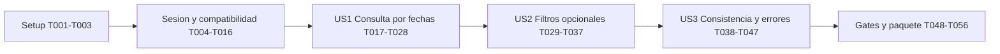

# Tasks: Reporte de ventas por fechas

**Input**: [spec.md](spec.md), [plan.md](plan.md), [research.md](research.md), [data-model.md](data-model.md), [API](contracts/api.md), [UI](contracts/ui.md) y [quickstart.md](quickstart.md).

**Prerequisites**: Diseno aprobado y ampliacion de login autorizada el 2026-11-03.
**Status**: T001-T060 completadas y verificadas en aislamiento; revision de sesion general y combos, evidencia y limites en quickstart.md. Sin despliegue productivo.
**Tests**: Incluir pruebas del comportamiento modificado conforme a constitucion III,
los escenarios de la especificacion y los gates del plan. Escribirlas antes de la
implementacion correspondiente y comprobar sus fallos; no contar un fallo de entorno
o compilacion como evidencia suficiente de un fallo de comportamiento.
**Organization**: Setup, infraestructura bloqueante y un incremento comprobable por historia.

## Format: `[ID] [P?] [Story] Description`

- Todas las tareas usan checkbox, identificador secuencial y rutas concretas.
- `[P]` permite trabajo paralelo solo dentro de los lotes y prerrequisitos indicados.
- `[US1]`, `[US2]` y `[US3]` corresponden a las historias de la especificacion.
- No crear ramas, commits, endpoints adicionales, migraciones de negocio ni reglas
  de pago fuera de los contratos. No revertir cambios previos del usuario.

## Path Conventions

Todas las rutas de tareas son relativas a la raiz de CarWash.Mobile:

- `app/`: aplicacion Android existente; paquete nuevo `com.carwash.mobile.reportes`.
- `../CarWashApi/`: API existente, proyecto `Carwash.API.csproj`.
- `../CarWashApi.Tests/`: proyecto hermano de pruebas propuesto; reutilizar uno
  compatible si existe al implementar, registrando la ruta real en quickstart.md.
- `../CarWash/`: escritorio WinForms existente, sin cambiar reglas de cobro.
- `specs/006-reporte-ventas/`: evidencia, contratos y seguimiento de esta funcionalidad.

Los archivos nuevos mencionados son destinos propuestos, no afirmaciones de existencia.
Reutilizar clases y auxiliares locales adecuados; no crear un archivo por cada caso.

## Phase 1: Setup (Shared Infrastructure)

**Purpose**: Preparar herramientas y pruebas aisladas sin iniciar el servicio real.

- [X] T001 Confirmar proyectos, instrucciones aplicables y cambios previos en `app/build.gradle.kts`, `../CarWashApi/Carwash.API.csproj` y `../CarWash/Controladores/LoginController.cs`; localizar la solucion real del escritorio y herramientas disponibles, y registrar rutas y bloqueos en `specs/006-reporte-ventas/quickstart.md` sin leer secretos ni cambiar red o servicios.
- [X] T002 Crear o reutilizar `../CarWashApi.Tests/Carwash.API.Tests.csproj` para net9.0, xUnit/VSTest, Microsoft.AspNetCore.Mvc.Testing y SQLite 9.0.14, referenciando `../CarWashApi/Carwash.API.csproj` sin incluir fuentes de test dentro del proyecto web ni actualizar dependencias ajenas.
- [X] T003 Preparar `../CarWashApi.Tests/Fixtures/CarWashApiFactory.cs` con SQLite temporal, esquema completo y datos sinteticos A-I del quickstart, sustitucion de TimeProvider y clientes de notificacion; adaptar el punto de entrada de `../CarWashApi/Program.cs` solo si hace falta para el host de pruebas y demostrar que su DDL de arranque nunca alcanza la base real.

**Checkpoint**: Fixture aislada disponible y rutas de los tres proyectos verificadas.

## Phase 2: Foundational (Blocking Prerequisites)

**Purpose**: Sesion verificable y compatibilidad comun a todas las historias.
**Blocking**: Completar T001-T016 antes de integrar historias; no desplegar la API
con lecturas endurecidas sin el escritorio actualizado.

- [X] T004 [P] Escribir en `../CarWashApi.Tests/AuthSessionTests.cs` pruebas del contrato de login aditivo, token invalido, caducidad inactiva/absoluta con reloj falso, concurrencia, capacidad, logout idempotente, reinicio y perfil vigente; comprobar rechazos sin depender de datos reales (despues de T003).
- [X] T005 [P] Ampliar `app/src/test/java/com/carwash/mobile/auth/AuthRepositoryTest.kt` y `app/src/test/java/com/carwash/mobile/auth/LoginViewModelTest.kt` para token solo en memoria, lectura de X-Server-Date, login sin token, reingreso, logout sin red y ausencia de reenvio de credenciales; conservar regresion del cifrado y servidores existentes (despues de T003).
- [X] T006 Implementar registro de sesiones en `../CarWashApi/Services/ApiSessionStore.cs` y opciones en `../CarWashApi/Configuration/SessionOptions.cs`: 32 bytes de RandomNumberGenerator, Base64Url, solo SHA-256 almacenado, operaciones atomicas, TimeProvider UTC, 9 horas absolutas sin limite inactivo (revision T058), limpieza de expirados y maximo 10000 sesiones con 503 sin expulsar vigentes (despues de T004).
- [X] T007 Implementar esquema en `../CarWashApi/Services/SessionAuthenticationHandler.cs` y politica Administrador en `../CarWashApi/Services/AdministradorAuthorizationHandler.cs`, reutilizando `../CarWashApi/Services/PerfilAdministrador.cs`; registrar servicios y UseAuthentication antes de UseAuthorization en `../CarWashApi/Program.cs`, verificando usuario no eliminado y perfil actual en cada lectura (despues de T006).
- [X] T008 Ampliar `../CarWashApi/Controllers/AuthController.cs` y sus DTO existentes para accessToken/tokenType/expiresAt/idleTimeoutSeconds solo en login exitoso, X-Server-Date y Cache-Control no-store; agregar POST logout idempotente conforme al contrato, sin cambiar credenciales/cifrado, cuerpos heredados ni registrar tokens (despues de T007).
- [X] T009 Aplicar politica Administrador a todos los GET de `../CarWashApi/Controllers/TurnosMovimientosController.cs`, conservando parametros, respuestas y FechaHoraIngreso del historico; no modificar POST/PUT/DELETE ni imponer autorizacion global a otros controllers (despues de T008).
- [X] T010 Ampliar `app/src/main/java/com/carwash/mobile/auth/AuthRepository.kt` para leer Response<LoginResponse>, credencial efimera ligada al origen, vencimiento y fecha operativa; conservar login y fallback existentes sin transferir un token del servidor autenticado al alterno (despues de T005 y T008).
- [X] T011 Adaptar `app/src/main/java/com/carwash/mobile/auth/LoginViewModel.kt`, `LoginScreen.kt` y `SessionStore.kt` del mismo paquete para reingreso al reporte, logout remoto con descarte local inmediato y restauracion solo de metadatos; no guardar token/contrasena en preferencias, Bundle o SavedState ni prometer revocacion remota sin respuesta (despues de T010).
- [X] T012 Adaptar `../CarWash/Controladores/LoginController.cs` y `../CarWash/Utilidades/clsConnection.cs` para recibir los campos aditivos, conservar token/origen solo en memoria y descartarlos/revocar al salir mediante el flujo de cierre existente identificado en T001; no persistir credenciales ni cambiar validacion de usuarios (despues de T008).
- [X] T013 Adaptar `../CarWash/Controladores/TurnosMovimientosController.cs` para adjuntar Bearer por solicitud al origen autenticado, sin redirecciones a otros origenes; propagar 401/403 como errores de acceso en vez de listas vacias y conservar el DTO historico y RegistrarTurnoMovimiento sin alterar el cobro (despues de T012).
- [X] T014 Restringir consultas historicas a Administrador y manejar reingreso/permiso en `../CarWash/Presentacion/Consultas/FrmConsultaMovimientosCaja.cs` y `../CarWash/Presentacion/Consultas/FrmReporteDiarioVentas.cs`; conservar filtros, contenido y flujos operativos permitidos para otros perfiles (despues de T013).
- [X] T015 Completar `../CarWashApi.Tests/AuthSessionTests.cs` con todos los GET heredados de movimientos: 401 sin sesion/inventada/vencida/revocada y 403 no administrador, rol modificado y usuario eliminado; comprobar que no se filtran datos y que los contratos exitosos heredados y escrituras de cobro no se alteraron (despues de T009).
- [X] T016 Ejecutar pruebas de sesion API, pruebas JVM de autenticacion y comprobacion aislada de login/historico/logout del escritorio actualizado; registrar comandos y resultados reales en `specs/006-reporte-ventas/quickstart.md`, manteniendo bloqueados los pasos que no puedan verificarse (despues de T011, T014 y T015).

**Checkpoint**: Sesion validada en servidor, credencial efimera en ambos clientes y
lecturas heredadas protegidas; ninguna confianza en idUsuario o isAdmin del cliente.

## Phase 3: User Story 1 - Consultar ventas de un periodo (Priority: P1) - MVP

**Goal**: Administrador consulta cobros por fechas, detalle y resumen global sin
seleccionar opcionales; conserva acceso a ingreso y vehiculos en proceso.
**Independent Test**: Con conjunto sintetico A-E, consultar solo fechas y obtener
dos movimientos por 120.30, incluido cobro de turno ingresado fuera del periodo;
sin sesion/perfil autorizado no se obtiene el reporte, tampoco por acceso directo.
**Prerequisite**: T016 completada. La base compartida de consulta puede soportar
los predicados opcionales desde esta historia; sus opciones y controles se entregan en US2.

### Tests for User Story 1

- [X] T017 [P] [US1] Escribir `../CarWashApi.Tests/ReporteVentasTests.cs` para GET ventas: fechas obligatorias/invalidas/mismo dia, medianoches, pagos parciales/Credito, varios servicios, relaciones descriptivas ausentes, 0.10 + 0.20 exacto, resumen global, cero coincidencias, 401/403 y ausencia de escrituras/PII; usar SQLite real de la fixture y fallar antes de implementar la ruta.
- [X] T018 [P] [US1] Escribir `app/src/test/java/com/carwash/mobile/reportes/ReporteVentasRepositoryTest.kt` con MockWebServer para fechas sin opcionales, esquema JSON, BigDecimal, offset de negocio, pagina inicial, X-Server-Date y errores 400/401/403/503; verificar header Bearer y aislamiento de origen sin reenvio al alterno.
- [X] T019 [P] [US1] Escribir `app/src/androidTest/java/com/carwash/mobile/ReporteVentasScreenTest.kt` para fechas obligatorias, consulta solo por fechas, resumen/detalle/vacio, bloqueo por perfil y acceso a los tres destinos con repositorio simulado, sin escrituras reales.

### Implementation for User Story 1

- [X] T020 [P] [US1] Crear DTO inmutables de consulta/criterios/movimiento/resumen en `../CarWashApi/DTOs/ReporteVentasDto.cs` con campos del contrato, DateOnly/DateTimeOffset, validacion de rango/ids/pageSize y cadenas monetarias invariantes sin cambiar serializacion global (despues de T017-T019).
- [X] T021 [P] [US1] Crear `app/src/main/java/com/carwash/mobile/reportes/ReporteVentasModels.kt` con LocalDate, criterios normalizados, importes BigDecimal, pagina/resultado y estados diferenciados; no serializar ni persistir la credencial junto al estado de pantalla (despues de T017-T019).
- [X] T022 [US1] Implementar `../CarWashApi/Services/ReporteVentasService.cs`: raiz TurnosMovimientos, rango semiabierto local sobre FechaMovimiento, opcionales AND por ids/placa, LEFT JOIN, una fila por movimiento, Count/Sum decimal ef_sum antes del cursor y lectura transaccional corta; orden fecha/id descendente, cursor ligado a criterios, 50/200 filas y valores descriptivos null, sin alterar importes o estados (despues de T020).
- [X] T023 [US1] Crear GET `api/Reportes/Ventas` en `../CarWashApi/Controllers/ReportesController.cs`, registrar el servicio en `../CarWashApi/Program.cs` y documentar respuestas OpenAPI; aplicar Administrador, X-Server-Date/no-store, criterios efectivos y ProblemDetails seguros con cancelacion RequestAborted, sin depender de caja abierta (despues de T022).
- [X] T024 [US1] Implementar `app/src/main/java/com/carwash/mobile/reportes/ReporteVentasRepository.kt` con Retrofit y modelos existentes para la consulta/pagina, mapeo decimal y errores de contrato; enviar solo fechas obligatorias y opcionales no nulos, Bearer solo al origen autenticado y sin redirecciones externas ni fallback con token (despues de T021 y T023).
- [X] T025 [US1] Crear `app/src/main/java/com/carwash/mobile/reportes/ReporteVentasViewModel.kt` con fechas operativas, validacion local, consulta inicial y continuacion basica, resumen global no acumulativo, estados vacio/error y control de generacion; no exigir otros filtros ni emitir exito sin respuesta (despues de T024).
- [X] T026 [US1] Crear `app/src/main/java/com/carwash/mobile/reportes/ReporteVentasScreen.kt` con selectores Material 3, Consultar, resumen, lista por movimiento y Cargar mas cuando exista cursor; incluir textos/semantica en `app/src/main/res/values/strings.xml`, Sin informar para nulls y formato monetario existente, sin truncar resultados silenciosamente (despues de T025).
- [X] T027 [US1] Reemplazar showVehicles por destino explicito en `app/src/main/java/com/carwash/mobile/MainActivity.kt`: Ingreso/Vehiculos/Reporte con NavigationBar o NavigationRail segun ancho, tercer destino solo Administrador, reingreso si falta token y retorno a Ingreso sin perder el formulario; integrar logout y limpieza de datos por usuario/origen (despues de T026 y T011).
- [X] T028 [US1] Ejecutar pruebas de US1 y regresion de login, ingreso y asignacion en `../CarWashApi.Tests/ReporteVentasTests.cs`, `app/src/test/java/com/carwash/mobile/reportes/ReporteVentasRepositoryTest.kt` y `app/src/androidTest/java/com/carwash/mobile/ReporteVentasScreenTest.kt`; registrar el esperado A-E, comandos y bloqueos reales en `specs/006-reporte-ventas/quickstart.md` (despues de T027).

**Checkpoint**: MVP demostrable con datos aislados. No publicar como entrega completa
antes de US2/US3 y los gates finales de seguridad, regresion y empaquetado.

## Phase 4: User Story 2 - Combinar filtros opcionales (Priority: P2)

**Goal**: Combinar forma de pago, operario, placa y tipo de vehiculo; cualquier
opcional sin seleccionar significa todos, no un valor obligatorio o un id cero.
**Independent Test**: Comparar ids de movimientos de cada filtro y todas sus
combinaciones contra el conjunto sintetico esperado; limpiar conserva fechas y
recupera todos los cobros del periodo, incluidos sin descripcion e historicos inactivos.
**Prerequisite**: T028. Se prueba esta historia sin depender de mejoras de US3.

### Tests for User Story 2

- [X] T029 [P] [US2] Ampliar `../CarWashApi.Tests/ReporteVentasTests.cs` con filtros solos/combinados por ids, nombres repetidos, placa completa normalizada, ids positivos inexistentes, ids 0/-1 invalidos y GET Filtros con catalogos independientes del periodo, sin eliminados donde el modelo tiene indicador (revision T057); verificar autorizacion previa a catalogos y cobros historicos conservados.
- [X] T030 [P] [US2] Ampliar `app/src/test/java/com/carwash/mobile/reportes/ReporteVentasRepositoryTest.kt` para GET Filtros, omision real de query params no seleccionados y parseo de catalogos con nombres null, sin enviar Todas/Todos ni valores centinela al servidor.
- [X] T031 [P] [US2] Ampliar `app/src/androidTest/java/com/carwash/mobile/ReporteVentasScreenTest.kt` para cuatro opcionales, menus con valores historicos, Limpiar filtros conservando fechas y seleccion mantenida al cambiar a periodo sin esa opcion, sin ampliar la consulta silenciosamente.

### Implementation for User Story 2

- [X] T032 [US2] Extender `../CarWashApi/DTOs/ReporteVentasDto.cs` y `../CarWashApi/Services/ReporteVentasService.cs` para opciones id/nombre desde catalogos completos independientes del periodo, excluyendo eliminados donde existe indicador (revision T057); verificar predicados AND y normalizacion de placa sobre datos y consulta sin eliminar cobros por joins (despues de T029-T031).
- [X] T033 [US2] Implementar GET `api/Reportes/Ventas/Filtros` en `../CarWashApi/Controllers/ReportesController.cs` con fechas obligatorias, Administrador, fecha operativa, no-store, validacion y errores del contrato; no reutilizar catalogos de operarios disponibles para lavado (despues de T032).
- [X] T034 [US2] Ampliar `app/src/main/java/com/carwash/mobile/reportes/ReporteVentasModels.kt` y `ReporteVentasRepository.kt` del mismo paquete para cargar opciones por fechas y transmitir las selecciones opcionales por id sin restricciones implicitas (despues de T033).
- [X] T035 [US2] Extender `app/src/main/java/com/carwash/mobile/reportes/ReporteVentasViewModel.kt` con forma de pago/operario/tipo/placa, carga de opciones por periodo, selecciones conservadas aunque no aparezcan, Limpiar filtros manteniendo fechas y reset de cursor al consultar criterios nuevos (despues de T034).
- [X] T036 [US2] Agregar seccion plegable de opcionales en `app/src/main/java/com/carwash/mobile/reportes/ReporteVentasScreen.kt` y recursos en `app/src/main/res/values/strings.xml`: Todas/Todos, menus Material e input de placa, sin convertir ningun opcional en obligatorio ni consultar automaticamente al editar (despues de T035).
- [X] T037 [US2] Ejecutar la matriz de filtros de `../CarWashApi.Tests/ReporteVentasTests.cs`, pruebas JVM/Compose correspondientes y comparacion de ids/importe/cantidad en `specs/006-reporte-ventas/quickstart.md`; demostrar que US1 sin opcionales mantiene su resultado (despues de T036).

**Checkpoint**: Las selecciones determinan exactamente la interseccion de resultados;
sin seleccion se incluyen todas las formas de pago, operarios y tipos.

## Phase 5: User Story 3 - Interpretar resultados y recuperarse de errores (Priority: P3)

**Goal**: Distinguir criterios editados de aplicados, completar paginas y reintentar
errores sin totales falsos, datos mezclados o respuestas de consultas antiguas.
**Independent Test**: Con varias paginas y servicios por turno, recorrer movimientos
unicos y verificar resumen; simular error/reintento, cambios concurrentes y respuestas
fuera de orden para comprobar que solo la consulta vigente cambia el reporte.
**Prerequisite**: T037; seguridad, precision y paginacion basica ya deben funcionar.

### Tests for User Story 3

- [X] T038 [P] [US3] Ampliar `../CarWashApi.Tests/ReporteVentasTests.cs` con empates de fecha, mas de dos paginas, cursor malformado/de otros criterios, resumen independiente del cursor, cambios entre paginas, datos esenciales invalidos y cancelacion/errores sanitizados; verificar recorrido completo con datos estables.
- [X] T039 [P] [US3] Crear `app/src/test/java/com/carwash/mobile/reportes/ReporteVentasViewModelTest.kt` con repositorio falso y coroutines-test para respuestas antiguas, cancelacion, doble Cargar mas, resumen no acumulativo, reintento de pagina, cambio de agregados, edicion sin consulta y limpieza por 401/403/usuario/origen.
- [X] T040 [P] [US3] Ampliar `app/src/androidTest/java/com/carwash/mobile/ReporteVentasScreenTest.kt` con etiquetas de criterios aplicados, resultados anteriores, error distinto de vacio, pagina parcial, Actualizar y reingreso/sin permiso; no usar la API real para simular estados.

### Implementation for User Story 3

- [X] T041 [US3] Completar manejo de errores/cancelacion y coherencia de pagina en `../CarWashApi/Services/ReporteVentasService.cs` y `../CarWashApi/Controllers/ReportesController.cs`: validar clave/huella de cursor sin SQL dinamico inseguro, zona operativa e importes sin inventar datos, 400/503/500 seguros y transaccion corta; no prometer snapshot entre peticiones (despues de T038-T040).
- [X] T042 [US3] Completar en `app/src/main/java/com/carwash/mobile/reportes/ReporteVentasViewModel.kt` separacion entre filtros editados/criterios aplicados y Job/numero de generacion; ignorar respuestas anteriores incluso si no cooperan con cancelacion o cambia usuario/origen (despues de T041).
- [X] T043 [US3] Completar en `app/src/main/java/com/carwash/mobile/reportes/ReporteVentasViewModel.kt` una sola continuacion a la vez, ids sin duplicados, error de pagina reintentable con mismo cursor y resumen no acumulativo; si cambia cantidad/total, no mezclar la nueva pagina y exigir Actualizar desde el inicio (despues de T042).
- [X] T044 [US3] Completar mapeo seguro de ProblemDetails/red y 401/403 en `app/src/main/java/com/carwash/mobile/reportes/ReporteVentasRepository.kt`, conservando cancelacion sin convertirla en vacio y sin reautenticar automaticamente con contrasenas guardadas (despues de T043).
- [X] T045 [US3] Completar estados y acciones en `app/src/main/java/com/carwash/mobile/reportes/ReporteVentasScreen.kt` y `app/src/main/res/values/strings.xml`: criterios realmente aplicados, resultado anterior, parcial/error sin falso cero, Reintentar, Actualizar y continuacion deshabilitada durante carga (despues de T044).
- [X] T046 [US3] Verificar y ajustar ciclo de vida en `app/src/main/java/com/carwash/mobile/MainActivity.kt`, `auth/LoginViewModel.kt` y `reportes/ReporteVentasViewModel.kt` bajo el mismo paquete: rotacion conserva ViewModel, muerte de proceso no recupera token/ventas, 403 retira destino y logout/cambio de usuario limpia el reporte sin modificar ingreso/asignacion (despues de T045).
- [X] T047 [US3] Ejecutar los escenarios de US3 en `../CarWashApi.Tests/ReporteVentasTests.cs`, `app/src/test/java/com/carwash/mobile/reportes/ReporteVentasViewModelTest.kt` y `app/src/androidTest/java/com/carwash/mobile/ReporteVentasScreenTest.kt`; registrar recorridos, errores y carreras verificadas en `specs/006-reporte-ventas/quickstart.md` (despues de T046).

**Checkpoint**: Las tres historias estan verificadas de forma incremental; los datos
son de una consulta viva y los limites de consistencia estan documentados.

## Phase 6: Polish & Cross-Cutting Concerns

**Purpose**: Cerrar riesgos comunes, evidencia y paquete sin operar sobre produccion.

- [X] T048 Validar y ajustar accesibilidad en `app/src/main/java/com/carwash/mobile/reportes/ReporteVentasScreen.kt`, `app/src/main/res/values/strings.xml` y `app/src/androidTest/java/com/carwash/mobile/ReporteVentasScreenTest.kt`: claro/oscuro, fuente ampliada, vertical/horizontal, lector de pantalla, teclado y calendario en otra zona horaria, sin superposiciones ni desplazamiento del dia seleccionado (despues de T047).
- [X] T049 Revisar `../CarWashApi/Program.cs`, `../CarWashApi/Controllers/AuthController.cs`, `app/src/main/java/com/carwash/mobile/auth/SessionStore.kt` y `../CarWash/Controladores/TurnosMovimientosController.cs` para demostrar ausencia de tokens/credenciales/PII en logs o almacenamiento, proteccion de los cinco GET y bloqueo de reenvio a origen ajeno; anotar alcance y riesgo de HTTP privado en `specs/006-reporte-ventas/quickstart.md`.
- [X] T050 Ejecutar `.\gradlew.bat :app:testDebugUnitTest :app:assembleDebug :app:lintDebug` y `.\gradlew.bat :app:connectedDebugAndroidTest` desde la raiz; registrar comandos, dispositivo y conteos reales en `specs/006-reporte-ventas/quickstart.md` y no marcar el gate como completo si falta dispositivo o hay fallos introducidos.
- [X] T051 Ejecutar `dotnet test ../CarWashApi.Tests/Carwash.API.Tests.csproj`, `dotnet build ../CarWashApi/Carwash.API.csproj --no-restore` y la compilacion real del escritorio identificada en T001; validar login/historico/cobro existente contra la instancia aislada y registrar evidencia o bloqueos en `specs/006-reporte-ventas/quickstart.md`.
- [X] T052 Medir SC-001 y SC-005 con 1000 cobros sinteticos segun `specs/006-reporte-ventas/quickstart.md`: menos de 30 segundos para solicitar por fechas y al menos 19/20 consultas con resumen/primer detalle visibles antes de 5 segundos; registrar equipo/red/tiempos y, si falla, medir antes de proponer indices o ampliar el diseno.
- [X] T053 Actualizar `README.md`, `docs/instalacion-api.md` y `../CarWashApi/README.md` con reporte, fechas/opcionales, sesion temporal, caducidad, reingreso, permisos de lecturas, configuracion no secreta y actualizacion coordinada; sin secretos, rutas locales del SDK ni cambios de negocio.
- [X] T054 Regenerar el paquete API con `installer/build.ps1` despues de los gates de T049-T053, comprobar inclusion de login/logout/reporte y documentar artefactos en `docs/instalacion-api.md`; no ejecutar el instalador productivo, reiniciar servicios ni cambiar firewall automaticamente.
- [X] T055 Recorrer escenarios end-to-end de `specs/006-reporte-ventas/quickstart.md` con API, APK y escritorio actualizados en entorno aislado: Administrador completo, no administrador sin reporte pero con sus flujos permitidos y cliente viejo con 401 sin bypass; verificar que consultas no alteran cobros y registrar resultados reales (despues de T054).
- [X] T056 Reconciliar evidencia y alcance en `specs/006-reporte-ventas/spec.md`, `plan.md`, `contracts/api.md`, `contracts/ui.md`, `quickstart.md` y `tasks.md` del mismo directorio; marcar solo tareas efectivamente verificadas, conservar bloqueos abiertos y dejar constancia de que no se realizo auditoria global ni despliegue productivo (despues de T055).

## Ajustes solicitados: sesion unica y combos

- [X] T057 Excluir operarios/tipos eliminados en catalogos sin quitar cobros historicos, mostrar nombres sin IDs en combos y verificar seleccion por ID interno.
- [X] T058 Sesion API de 9 horas desde cada login, sin caducidad por inactividad ni renovacion por uso; probar limites y usuarios independientes.
- [X] T059 Eliminar reingreso exclusivo del reporte y cerrar toda la sesion movil a las 9 horas, incluso al volver de segundo plano; probar login compartido y limpieza.
- [X] T060 Verificar JVM/API/UI, compilar y lint; actualizar contratos y evidencia sin desplegar ni reemplazar servicio productivo.

## Dependencies & Execution Order

### Phase Dependencies

Setup T001-T003 -> Foundational T004-T016 -> US1 T017-T028 -> US2 T029-T037 ->
US3 T038-T047 -> Polish T048-T056.



### User Story Dependencies

- US1 no depende de otras historias; depende de la infraestructura y escritorio
  compatible de Phase 2. Su consulta base ya protege precision, orden y autorizacion.
- US2 reutiliza la consulta/modelos de US1 y entrega opciones/controles de filtros;
  se puede comprobar sin US3. No duplicar el servicio o el modelo para independizarla.
- US3 reutiliza US1/US2 y completa robustez de su recorrido. Los agregados correctos
  y errores basicos no se posponen a esta fase: ya son requisito de US1.
- Las historias no se integran en paralelo porque modifican los mismos archivos
  de servicio, ViewModel y pantalla. Independientemente comprobable no significa
  que no exista reutilizacion o dependencia incremental.

### Within Each Phase

- Completar Setup antes de los lotes de pruebas; infraestructura es bloqueante.
- T004/T005 pueden escribirse en paralelo. T006-T009 cubren servidor;
  T010-T011 dependen del login aditivo. T012-T014 cubren escritorio y dependen de T008.
  Sus comprobaciones confluyen en T016; no endurecer produccion entre esos pasos.
- En cada historia, el lote de pruebas va antes del de implementacion. Correr los
  checks enfocados al terminar cada modificacion y reparar la misma capa antes de
  ampliar el alcance; T028/T037/T047 son checkpoints, no sustituyen esa disciplina.
- T020/T021 son un lote paralelo de modelos solo despues de T017-T019; despues
  respetar las dependencias expresas. El resto de tareas sin `[P]` se ejecuta en
  orden de identificador salvo dependencia mas especifica indicada.
- Todos los gates finales deben cerrar antes de empaquetar. Dispositivo/herramienta
  ausentes dejan el gate bloqueado, no una tarea exitosa. Paquete no implica despliegue.

### Parallel Opportunities

Solo se marcan 13 tareas `[P]`: T004/T005, T017/T018/T019, T020/T021,
T029/T030/T031 y T038/T039/T040. Son lotes separados con sus prerrequisitos;
no lanzarlos todos juntos ni modificar el mismo archivo desde varios trabajos.

## Parallel Example: User Story 1

```text
Prerequisito: T016 completo.
Lote A: T017 pruebas HTTP/SQLite | T018 pruebas repositorio JVM | T019 pruebas Compose.
Prerequisito: lote A escrito y comprobado antes de implementar.
Lote B: T020 DTO API | T021 modelos Android.
Despues: T022 -> T023 -> T024 -> T025 -> T026 -> T027 -> T028.
```

## Parallel Example: User Story 2

```text
Prerequisito: T028 completo.
T029 pruebas filtros API | T030 contrato repositorio JVM | T031 pruebas controles Compose.
Despues, implementacion serial T032-T037 por archivos compartidos con US1.
```

## Parallel Example: User Story 3

```text
Prerequisito: T037 completo.
T038 pruebas paginacion API | T039 pruebas ViewModel JVM | T040 pruebas errores Compose.
Despues, implementacion serial T041-T047 por archivos compartidos con US1/US2.
```

## Implementation Strategy

### MVP First (User Story 1 Only)

1. Completar infraestructura y sesion temporal, incluidos clientes y control de GET heredados.
2. Completar US1: fechas obligatorias, cobros reales de la fixture, resumen y detalle,
   recorrido basico y acceso exclusivo Administrador en API y movil.
3. Demostrar A-E y precision decimal en entorno aislado, sin alterar cobros reales.
4. No confundir MVP de demostracion con entrega completa: filtros, robustez y gates
   finales son necesarios para cumplir todo el pedido y empaquetar.

### Incremental Delivery

1. US1 demuestra el reporte seguro por fechas.
2. US2 agrega las selecciones opcionales y verifica el significado de todos/sin filtro.
3. US3 verifica recorridos, reintentos y ausencia de datos obsoletos o mezclados.
4. Cerrar seguridad, accesibilidad, builds, dispositivos y metricas; luego empaquetar
   y documentar la ventana coordinada. No desplegar automaticamente en produccion.

### Parallel Team Strategy

Usar solo los lotes `[P]` descritos, con limites de archivos. API/movil/escritorio
pueden investigarse por separado, pero integrar respetando login y contratos.
No se ejecutan agentes o tareas de implementacion durante esta generacion.

## Coverage & Completion Criteria

| Requisitos u objetivo | Tareas principales |
|----------------------|--------------------|
| FR-001 | T019, T027, T048 |
| FR-002 | T017, T020-T027, T048 |
| FR-003 | T017, T022, T028 |
| FR-004 | T007-T009, T014-T019, T023, T033, T049 |
| FR-005, FR-006, FR-007, FR-008 | T022, T029-T037 |
| FR-009, FR-010, FR-011 | T017-T026, T038, T041, T043 |
| FR-012, FR-013 | T025, T038-T047 |
| FR-014, FR-016 | T017, T022-T024, T049, T055 |
| FR-015 | T019, T026-T027, T040, T048, T050 |
| FR-017 | T004-T016, T046, T049, T051, T055 |
| SC-001, SC-005 | T052 |
| SC-002, SC-003, SC-004 | T017-T019, T028-T037, T038-T047 |
| SC-006, SC-008 | T004-T016, T017, T049, T051, T055 |
| SC-007 | T038-T047 |

**Conteos**: 56 tareas: Setup 3, Foundational 13, US1 12, US2 9, US3 10 y Polish 9.
**Notes**: Actualizar tareas y evidencia conforme se ejecutan. No crear commits sin
autorizacion. No afirmar pruebas exitosas, precision medida o despliegue sin ejecutarlos.
- [X] T057 Filtros completos desde tablas (FR-008) y tabla de resumen por forma de pago en API (`resumen`) y pantalla (FR-018); compilacion, pruebas unitarias y lint ejecutados; prueba manual del resumen pendiente de reinstalar el API.
